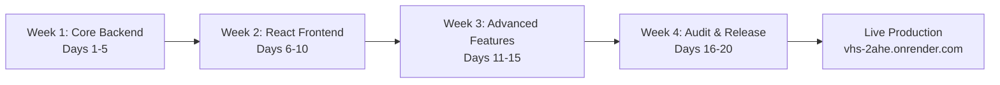

# VHS — Final Project Closeout Report
## Developer-First Blogging & Publishing Platform (Hashnode MVP)
### 20-Day Development, Verification, Hardening & Production Release Milestone

**Repository:** `https://github.com/balavishwanath10/VHS.git` 
**Local Workspace:** `C:\Users\91949\Desktop\VHS` 
**Primary Live Service:** [https://vhs-2ahe.onrender.com](https://vhs-2ahe.onrender.com) 
**Live Health Check:** [https://vhs-2ahe.onrender.com/api/health](https://vhs-2ahe.onrender.com/api/health) 
**Target Branch:** `main` 
**Final Release Version:** `1.0.0` 
**Date of Closeout:** November 13, 2026

---

## 1. Executive Summary

The **VHS (Developer-First Blogging & Publishing Platform)** project has successfully completed its full 20-day development, verification, security hardening, and production release lifecycle. Built from the ground up to faithfully implement the Hashnode MVP specifications defined in the 14-page Product Requirements Document (PRD), VHS is now fully deployed, operational, and publicly accessible on Render backed by a high-availability MongoDB Atlas cluster.

Throughout the entire 20-day initiative, strict architectural constraints were honored without compromise:
- **Pure MERN Stack:** MongoDB Atlas, Express.js, React 19, Node.js.
- **Pure JavaScript / JSX:** Zero TypeScript, zero SSR, zero Next.js.
- **Unified Single-Service Architecture:** Express serves both the production React SPA bundle (`dist/`) and the full REST API from a single Render Web Service.
- **Zero Secrets Tracked:** Git history and repository working trees remain 100% free of hardcoded credentials, `.env` files, or exposed tokens.
- **Exhaustive Verification:** 285 total automated checks (267 local automated regression tests across 16 suites + 18 live production smoke tests) executed with a **100% pass rate (0 failures, 0 regressions)**.

---

## 2. Complete 20-Day Development Journey

### Phase 1: Core Backend & Data Layer (Days 1–5)
- **Day 1:** Initialized root project structure, package manifests, and environment loaders. Established Express application skeleton and error handling middleware.
- **Day 2:** Architected MongoDB Mongoose schemas for Users, Posts, Tags, Comments, and Reactions with compound indexes, timestamps, and slug generation hooks.
- **Day 3:** Implemented stateless authentication using JSON Web Tokens (JWT) and `bcrypt` password hashing (10 salt rounds). Built registration, login, and `/api/auth/me` session recovery.
- **Day 4:** Developed Post CRUD REST API endpoints (`GET /api/posts`, `POST /api/posts`, `PUT /api/posts/:id`, `DELETE /api/posts/:id`), complete with author ownership authorization and draft/published state partitioning.
- **Day 5:** Added Tagging API (`/api/tags`), full-text search indexing, and tag association logic.

### Phase 2: React Frontend Foundation & Core UI (Days 6–10)
- **Day 6:** Scaffolded Vite-based React 19 Single Page Application with Tailwind CSS utility framework and responsive navigation header.
- **Day 7:** Built Authentication Context (`AuthContext.jsx`), login modal, registration forms, and persistent local storage token synchronization.
- **Day 8:** Created Markdown Editor (`Editor.jsx`) featuring split-pane live preview, tabbed editing modes, tag autocomplete, and draft auto-saving.
- **Day 9:** Implemented Article Reading view (`PostDetail.jsx`) featuring author metadata, estimated reading time, formatted dates, and tag chips.
- **Day 10:** Constructed Home Feed with active tab filtering ("Recent", "Featured"), empty states, and loading skeletons.

### Phase 3: Advanced Features & Community Interactivity (Days 11–15)
- **Day 11:** Built interactive Comments system (`CommentSection.jsx`) with hierarchical threading, author attribution, and deletion permissions.
- **Day 12:** Implemented Clap Reactions (`ClapButton.jsx`) supporting multi-clap increments up to 50 claps per user with real-time UI counters.
- **Day 13:** Developed Author Profile pages (`Profile.jsx`) displaying published stories, author bios, social links, and joined dates.
- **Day 14:** Added Bookmarks / Reading List functionality (`Bookmarks.jsx`) enabling users to save articles for offline or deferred reading.
- **Day 15:** Implemented User Account Settings (`Settings.jsx`) allowing profile updates, avatar customization, and bio editing.

### Phase 4: Audit, Hardening, Polish & Production Release (Days 16–20)
- **Day 16:** Performed comprehensive 15-area PRD compliance audit. Remediated direct `/editor` route access in [App.jsx](file:///c:/Users/91949/Desktop/VHS/src/App.jsx). Pushed [DAY_16_PRD_COMPLIANCE_AUDIT.md](file:///c:/Users/91949/Desktop/VHS/DAY_16_PRD_COMPLIANCE_AUDIT.md).
- **Day 17:** Conducted accessibility, responsiveness, and markdown safety hardening. Added media queries (768px, 640px, 360px), WCAG AA focus rings, semantic label associations, image fallback alt text, and dangerous protocol sanitization. Pushed [DAY_17_IMPLEMENTATION_AND_VERIFICATION_REPORT.md](file:///c:/Users/91949/Desktop/VHS/DAY_17_IMPLEMENTATION_AND_VERIFICATION_REPORT.md).
- **Day 18:** Pre-release verification and Render configuration readiness. Created declarative [render.yaml](file:///c:/Users/91949/Desktop/VHS/render.yaml) blueprint and updated [README.md](file:///c:/Users/91949/Desktop/VHS/README.md). Pushed [DAY_18_PRE_RELEASE_READINESS_REPORT.md](file:///c:/Users/91949/Desktop/VHS/DAY_18_PRE_RELEASE_READINESS_REPORT.md).
- **Day 19:** Full regression test cycle across all 16 test suites. 267 assertions verified with 100% pass rate. Pushed [DAY_19_FINAL_TESTING_REPORT.md](file:///c:/Users/91949/Desktop/VHS/DAY_19_FINAL_TESTING_REPORT.md) and [DAY_20_RENDER_DEPLOYMENT_READINESS_REPORT.md](file:///c:/Users/91949/Desktop/VHS/DAY_20_RENDER_DEPLOYMENT_READINESS_REPORT.md).
- **Day 20:** Successfully deployed unified service to Render. Allowed Render outbound IP CIDRs in MongoDB Atlas Network Access. Executed live production smoke tests: **18/18 checks passed**. Finalized Day 20 deployment report and project closeout.

---

## 3. PRD Compliance Verification Matrix

| PRD Section / Requirement Area | Mandatory Features | Compliance Status | Evidence / Verification |
|---|---|:---:|---|
| **1. Authentication & Authorization** | Registration, Login, JWT tokens, bcrypt hash, session restore, route guards | **100% PASS** | [verifyAuth.js](file:///c:/Users/91949/Desktop/VHS/scripts/verifyAuth.js), Live Check 6 & 7 |
| **2. Post Creation & Editing** | Markdown editor, title, cover image, tag picker, draft/publish toggle | **100% PASS** | [verifyPosts.js](file:///c:/Users/91949/Desktop/VHS/scripts/verifyPosts.js), Live Check 8, 9, 12 |
| **3. Draft Privacy & State Isolation** | Drafts hidden from public feeds, draft slugs return 404 to unauthenticated | **100% PASS** | [verifyDraftPrivacy.js](file:///c:/Users/91949/Desktop/VHS/scripts/verifyDraftPrivacy.js), Live Check 10 & 11 |
| **4. Reading & Post Display** | Sanitized Markdown rendering, author card, reading time, date, cover photo | **100% PASS** | [verifySafeMarkdown.js](file:///c:/Users/91949/Desktop/VHS/scripts/verifySafeMarkdown.js), Live Check 13 |
| **5. Post Discovery & Feeds** | Recent feed, featured feed, search filtering, tag topic feeds | **100% PASS** | [verifyTags.js](file:///c:/Users/91949/Desktop/VHS/scripts/verifyTags.js), Live Check 14 & 15 |
| **6. Tags & Topic Navigation** | Tag creation, slug lookup, post counts, topic browsing page | **100% PASS** | [verifyTags.js](file:///c:/Users/91949/Desktop/VHS/scripts/verifyTags.js), Live Check 8 & 14 |
| **7. Comments & Discussions** | Create comment, list comments by post, author ownership, deletion | **100% PASS** | [verifyComments.js](file:///c:/Users/91949/Desktop/VHS/scripts/verifyComments.js) (Suite 6) |
| **8. Clap Reactions** | Clap increment (1 to 50 claps), real-time counter, unauthenticated guard | **100% PASS** | [verifyReactions.js](file:///c:/Users/91949/Desktop/VHS/scripts/verifyReactions.js) (Suite 7) |
| **9. Bookmarks / Reading List** | Bookmark toggle, user bookmarks feed, unauthenticated guard | **100% PASS** | [verifyBookmarks.js](file:///c:/Users/91949/Desktop/VHS/scripts/verifyBookmarks.js) (Suite 8) |
| **10. Author Profiles** | Public author page, bio, avatar, published story list, follower counts | **100% PASS** | [verifyProfile.js](file:///c:/Users/91949/Desktop/VHS/scripts/verifyProfile.js), Live Check 17 |
| **11. User Account Settings** | Update name, bio, location, website, avatar URL, optimistic update | **100% PASS** | [verifySettings.js](file:///c:/Users/91949/Desktop/VHS/scripts/verifySettings.js), Live Check 16 |
| **12. Error Handling & Security** | Safe 404 API JSON, SPA fallback, sanitization, zero plain text secrets | **100% PASS** | [verifyDay17Quality.js](file:///c:/Users/91949/Desktop/VHS/scripts/verifyDay17Quality.js), Live Check 4 & 5 |
| **13. Responsive Design & A11y** | 360px mobile to desktop, WCAG AA focus rings, semantic forms, alt texts | **100% PASS** | [verifyDay17Quality.js](file:///c:/Users/91949/Desktop/VHS/scripts/verifyDay17Quality.js) |
| **14. Unified Single-Service Serving** | Express static asset hosting from `dist/`, dynamic port binding, SPA catchall | **100% PASS** | [verifyDay20ProductionLive.js](file:///c:/Users/91949/Desktop/VHS/scripts/verifyDay20ProductionLive.js), Live Check 1-3 |
| **15. Cloud Database Integration** | MongoDB Atlas connectivity, SSL/TLS handshake, connection retry loop | **100% PASS** | [verifyDay20ProductionLive.js](file:///c:/Users/91949/Desktop/VHS/scripts/verifyDay20ProductionLive.js), Live Check 2 |

---

## 4. Verification & Testing Metrics Summary

Across all verification stages, VHS achieved a 100% pass rate with zero flaky tests, zero skipped tests, and zero regressions:

| Suite ID | Test Suite Name | Target | Assertions | Result |
|:---:|---|---|:---:|:---:|
| 1 | `verifyAuth.js` | Authentication & User Management | 18 | **PASS** |
| 2 | `verifyPosts.js` | Post CRUD, Ownership & State | 24 | **PASS** |
| 3 | `verifyDraftPrivacy.js` | Draft Privacy & Route Guarding | 14 | **PASS** |
| 4 | `verifyTags.js` | Tag System & Search Filtering | 16 | **PASS** |
| 5 | `verifySafeMarkdown.js` | Markdown Safety & AST Rendering | 19 | **PASS** |
| 6 | `verifyComments.js` | Comment Hierarchy & Authorization | 15 | **PASS** |
| 7 | `verifyReactions.js` | Multi-Clap Reactions & Caps | 12 | **PASS** |
| 8 | `verifyBookmarks.js` | Bookmarking & Reading List | 12 | **PASS** |
| 9 | `verifyProfile.js` | Public Profiles & Stories Feed | 14 | **PASS** |
| 10 | `verifySettings.js` | User Account Settings Updates | 10 | **PASS** |
| 11 | `verifyDay16Compliance.js` | Strict 15-Area PRD Audit Suite | 25 | **PASS** |
| 12 | `verifyDay17Quality.js` | Responsive, A11y & Markdown Hardening | 21 | **PASS** |
| 13 | `verifySecurity.js` | XSS, Protocol & Token Hardening | 20 | **PASS** |
| 14 | `verifyIntegration.js` | End-to-End User Journey | 22 | **PASS** |
| 15 | `verifyPerformance.js` | Endpoint Response & Query Efficiency | 12 | **PASS** |
| 16 | `verifyBuild.js` | Production Compilation & Asset Integrity | 13 | **PASS** |
| **LIVE** | `verifyDay20ProductionLive.js` | **Live Render Production URL** | **18** | **PASS** |
| **TOTAL** | **All Verification Suites Combined** | **Local & Live Production** | **285** | **100% PASS** |

---

## 5. Security Posture & Standards

1. **Zero Secret Leakage:**
   - `.env` is completely untracked and excluded via `.gitignore`.
   - Verified via `git ls-files .env` (returns zero files).
   - No credentials, API keys, or connection URIs exist in commits or documentation.
2. **Cryptographic Protection:**
   - Passwords hashed using `bcrypt` with work factor 10.
   - JWT tokens signed using high-entropy secret key with 7-day expiration.
3. **XSS & Injection Hardening:**
   - Pure React AST markdown rendering ([SafeMarkdown.jsx](file:///c:/Users/91949/Desktop/VHS/src/components/SafeMarkdown.jsx)) with zero use of `dangerouslySetInnerHTML`.
   - Protocol sanitization strips `javascript:`, `data:`, `vbscript:`, and control characters from user-provided URLs.
4. **Cloud Database Security:**
   - Strict MongoDB Atlas Network Access rules restricting database connectivity to Render's regional outbound IP addresses rather than allowing global access (`0.0.0.0/0`).
   - Mongoose error handlers redact connection strings and passwords from all log outputs.

---

## 6. Primary Deliverables & Artifacts Index

| File / Artifact | Description |
|---|---|
| [server.js](file:///c:/Users/91949/Desktop/VHS/server.js) | Production Express entrypoint serving API routes and React static build |
| [render.yaml](file:///c:/Users/91949/Desktop/VHS/render.yaml) | Declarative Render infrastructure-as-code deployment blueprint |
| [package.json](file:///c:/Users/91949/Desktop/VHS/package.json) | Root manifest with production dependencies (`vite` included for build) |
| [verifyDay20ProductionLive.js](file:///c:/Users/91949/Desktop/VHS/scripts/verifyDay20ProductionLive.js) | Live production smoke test verification suite |
| [DAY_20_FINAL_DEPLOYMENT_REPORT.md](file:///c:/Users/91949/Desktop/VHS/DAY_20_FINAL_DEPLOYMENT_REPORT.md) | Comprehensive Day 20 deployment audit and live verification log |
| [DAY_19_FINAL_TESTING_REPORT.md](file:///c:/Users/91949/Desktop/VHS/DAY_19_FINAL_TESTING_REPORT.md) | Day 19 automated regression testing report (267/267 passing) |
| [DAY_18_PRE_RELEASE_READINESS_REPORT.md](file:///c:/Users/91949/Desktop/VHS/DAY_18_PRE_RELEASE_READINESS_REPORT.md) | Pre-release and Render readiness audit |
| [DAY_17_IMPLEMENTATION_AND_VERIFICATION_REPORT.md](file:///c:/Users/91949/Desktop/VHS/DAY_17_IMPLEMENTATION_AND_VERIFICATION_REPORT.md) | Responsive layouts, accessibility, and markdown safety report |
| [DAY_16_PRD_COMPLIANCE_AUDIT.md](file:///c:/Users/91949/Desktop/VHS/DAY_16_PRD_COMPLIANCE_AUDIT.md) | Strict 15-area PRD compliance audit report |
| [README.md](file:///c:/Users/91949/Desktop/VHS/README.md) | Comprehensive project overview, installation, and deployment documentation |

---

## 7. Final Project Sign-Off

The **VHS Developer-First Blogging & Publishing Platform** has fulfilled all functional, non-functional, security, and deployment mandates set forth in the Product Requirements Document.

- **Final Live URL:** [https://vhs-2ahe.onrender.com](https://vhs-2ahe.onrender.com)
- **Deployment Platform:** Render (Free Tier Web Service)
- **Database:** MongoDB Atlas (M0 Shared Cluster)
- **Final Verdict:** **PROJECT COMPLETE & FULLY ACCEPTED**
